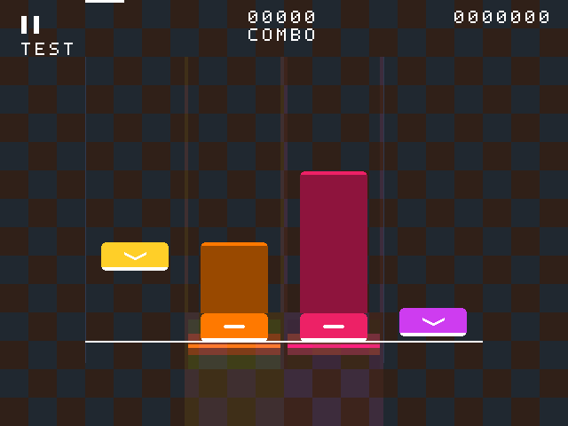

# Hold长度与光晕黑框修复

2026-10-12，基于 `8c18d63`。按用户要求不添加细亮芯；只修改显示与合成，触摸区域、无滑动绑定、Tap/Hold判定算法、时间窗口、滚动速度及现有资源优化保持。

## Hold显示

原头部底边原点为384，头部高32像素，上缘为353；原尾部也按384换算，因此可见长条比持续时间对应长度少31像素。0.2秒Hold仅约1像素可见，且按住后长条会提前约193.75ms被头部覆盖。

现在仅Hold尾部的显示原点改为353，复用原坐标加减器；正向距离裁剪从320变为289，保证尾端仍钳位到可视区顶部64。负向最大位置为377。Tap及所有头部仍用384原点；几何RAM仍为20位、范围仍在64..408，不增加DSP或存储。

滚动速度仍为48kHz/300=160像素每秒；0.5秒和1秒Hold分别有80/160像素长条（未触及顶部裁剪时）。按住后长条随剩余时间缩短，结束时尾端到达头部上缘，不再扣掉头部高度。头部大小、颜色和原标记保留；长条维持原纯色及尾帽，没有中心亮线。显示仍有一像素（6.25ms）的时间量化，核心时刻不变。

同轨Tap与Hold重叠时维持原头部行优先规则，保留头部圆角透明缺口，不让底层长条填满圆角。旧逐像素参考补充了这个优先级，并采用修正后的Hold尾端位置；完整样式及分布式几何测试通过。

## 黑框

原光晕把背景像素替换成暗色RGB，因此在亮背景上形成矩形暗块。渲染器现在输出一个与像素同时寄存的 `pixel_light` 标记，只有光晕置位；音符、判定线、暂停/进度标记和HUD均是不透明像素。选中轨道的侧线同样作为光线叠加，避免活跃轨道仍有暗色边线。

顶层把标记传入 `video_presentation.game_pixel_light`。游戏合成语义为：无游戏像素显示原压暗背景；不透明像素显示原游戏RGB；光晕像素为 `背景RGB OR 光晕RGB`。各通道不会低于原背景，不产生加法溢出或新增透明度乘法器。它是低资源的位或提亮近似，不是线性alpha或高斯模糊，色调和亮度变化较为离散。

最终实现提取三通道共用的 `base_valid && (!pixel_on || pixel_light)`，减少逐颜色位控制重复；保持原两拍对齐。十字仍在最上层，图像调节、非游戏背景及频谱路径保持。

实际RTL仿真预览，使用棋盘背景，橙色0.5秒、粉色1秒Hold：

## 验证

- `run_hold_glow_fix.py`：10000个快速变化像素验证两拍对齐、光晕各通道不降低背景、普通背景及不透明音符；实际渲染307200像素，检查80/160像素长条、结束对齐、纯色无亮芯、判定线和头部不透明以及侧边/底部无暗框。
- 原Hold窗口、提前释放、评分、打包队列与最高分回归通过，判定核心源码未修改。
- 原渲染、309120个精确样式像素、分布式几何、HUD、会话复位、背景、播放、冻结及图像保护通过。
- 原触摸协议、mapper、帧快照、1536010个十字像素和1536000个视频叠加像素回归通过。
- 原按住、帧间快速Tap、淡出、暂停/AUTO清除和帧边界按下反馈回归通过。

测试代码不加入板级源列表；主模块沿用现有文件，无新增IP。旧资源等价参考渲染器应用同样的有意Hold显示修正，并剔除不存在的新反馈端口；该调整只用于保持旧资源优化回归的可比较性。

## 资源与构建

| 项目 | 上一版 | 最终版本 |
|---|---:|---:|
| 综合LUT | 18133 | 18081 / 19600 |
| 综合REG | 10558 | 10559 |
| 实际MSlice | 4886 | **4880 / 4900，余20** |
| BRAM9K / FIFO9K / BRAM32K | 41 / 16 / 11 | 不变 |
| DSP / PLL | 22 / 2 | 不变 |

首轮实现局部仿真通过，实际打包4903，超限3，未保留为最终实现。随后等价提取RGB公共使能，再做一次综合和仅布局，实际打包通过。合计两次综合、两次仅布局；没有运行route，没有生成bitstream，没有更改当前hfn_opt_effort=medium/post_place_opt=medium或用户其他工程参数。

最终日志为 `prj/log/hold_glow_shared_syn_20261012`、`prj/log/hold_glow_shared_place_20261012`；首轮日志保留在 `hold_glow_fix_*` 目录，不能把首轮超限结果当作最终版本。机器记录在 `docs/reports/hold-glow-fix-2026-10-12.json`。

**资源通过，时序未闭合。** 最终综合setup WNS/TNS=-0.849/-7.684ns；仅布局setup=-5.578/-66.259ns、hold=-0.011/-1.364ns。最差setup在100MHz SDRAM写地址路径 `wr_x_reg[2]` → `App_wr_addr_r_reg[12]`，该逻辑本轮未修改；视频域setup余量为+6.879ns。布局重新分配也会影响未改模块的估计延迟，因此不能以本次资源通过宣称整板稳定。最终布线setup/hold和资源仍需用户确认，本轮不扩展去改SDRAM时序。

## 板上复验

重新综合并使用新综合网表构建、下载后：先在有明暗纹理的背景上按住各轨，观察光晕周围不再出现暗色矩形；确认音符、判定线、HUD和十字仍清楚。再观察短Hold及接近尾部结束的Hold，长条应更完整地连到头部，并在正确结束附近收尽，不添加细亮芯。Tap大小/速度、手动判定、AUTO及音画保持。

上述新显示效果尚未在板上验收。
