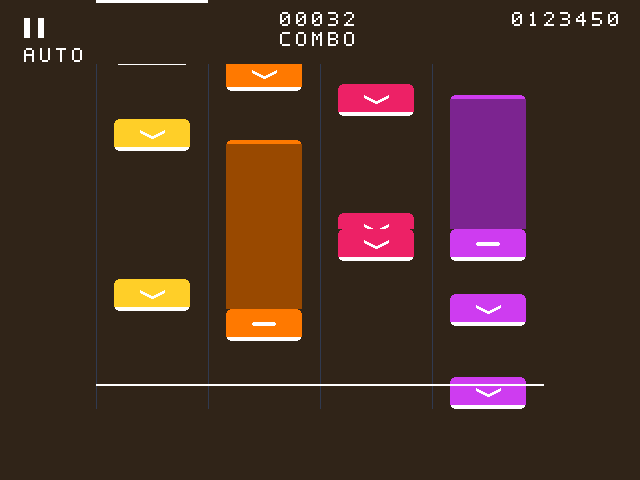

# 四轨音块样式实现与验证

用户先提供参考图，确认外观预览后授权修改。实现保留现有四轨位置、判定线、HUD、游戏会话和输入/判定逻辑，仅修改音块显示。

后续 [默认布线修复](rhythm-route-fix-2026-10-06.md) 保留本文图案，将头部/尾帽共用行描述以减少24个寄存器，并完成默认P&R。下方综合数据为首次样式版本快照；当前物理结果及未闭合时序以该后续记录为准。

## 样式与时间位置

| 轨道 | 音块/尾帽 RGB | 长条 RGB |
| --- | --- | --- |
| 1 | `FFCF28` 黄 | `997B18` |
| 2 | `FF7900` 橙 | `994900` |
| 3 | `ED2166` 玫红 | `8E143D` |
| 4 | `CE3CF0` 紫 | `7C2490` |

- 轨道仍宽 112 像素，音块宽度由 96 改为 76，居中占轨道局部 x=18..93。
- 头部高 32 像素，四角采用四像素阶梯圆角。底部四行白色横条，短音块中间显示白色向下箭头，Hold 头部显示四行白色短横。
- **头部底边对应原采样时间换算的 y**，图案向上展开 31 行；命中时底边落在 y=384 判定线，不改变歌曲时间、预取或判定窗。
- Hold 长条宽度与头部相同，从尾部 y 向下延伸至头部上沿；顶部四行亮色圆角尾帽，其他区域使用同轨暗色。持续时间不足以伸出头部时仍以短横识别 Hold。
- 沿用游戏区 y=64..408 裁剪、y=384/385 白色判定线和保持状态的 y=384 头部锚定。首行进入、末行退出的部分音块允许自然裁剪。
- 同轨头部相互重叠时优先显示靠近判定线的首槽，避免把不同头部的箭头/短横合并为混乱图案。

下面是**实际 RTL 输出的 640×480 仿真画面**，包含用于验证的重叠、顶部和底部裁剪音符；不是 imagegen 外观草案。



## 实现

`rhythm_game_renderer.v` 原先每轨每行只有头部/长条布尔掩码，无法表示 32 行的符号和圆角。新增行描述：每轨头部六位 `{Hold,图案行[4:0]}`、尾帽三位 `{有效,图案行[1:0]}`，与既有行掩码一起在行消隐中发布。

32 槽几何仍串行读取，下一行计算保持 64 拍，未增加快照停顿或像素延迟。符号和圆角用小范围坐标比较及常量配色实现，没有增加图案 RAM、DSP 或 IP。保留上一轮 `vs_seen_low` 的真实帧边界等待。

未修改顶层、接口、工程源集、管脚、PLL、时钟、厂商 IP、游戏引擎、SD 读取器、歌曲计时或双线性缩放。测试源不进入板级源集。

## 仿真

新增 `tb_rhythm_note_style.v` 的独立逐像素参考。箭头采用逐行笔画范围描述，与 RTL 的斜线计算表达式不同。参考从固定音符坐标构造图案，不读取 DUT 行描述作为期望值。

块 RAM 和分布式几何各检查两帧（普通/保持），每种 **309120** 个游戏区像素，两种共 **618240** 个精确 RGB 比较。覆盖四轨配色、76×32 尺寸、圆角、底边、箭头/短横、Hold 宽条和尾帽、同轨重叠、上下边界裁剪、保持头部锚定及输出延迟。

`tb_rhythm_renderer` 更新旧青色像素断言，继续检查图案填色、底边命中位置、长条、判定线、HUD、黑底回退和两拍最终 RGB。

完整八项回归通过：会话、显示、新图案、真实 VS 清理显示、播放、媒体冻结、图片保护、分布式几何图案。九个连续 VS 复位场景的 **2764800** 个恢复帧坐标继续全部对齐。编译零错误/零告警；播放保留三条既有可选端口未连接告警，其余回归零告警。

```powershell
python src/test/run_rhythm_stage4.py --output prj/log/rhythm_note_style_20261006/regression
```

图案参考输出 `prj/log/rhythm_note_style_20261006/notes.ppm` / `held.ppm`；仅作无损格式转换生成 PNG 供查看。

## 综合与实际限制

隔离综合使用与顶层一致的 `BLOCK_GEOMETRY=1`、`STREAM_METADATA=1`、`BLOCK_HUD=1`。对照仅改变渲染器版本，三个参数通过临时源码副本的默认值设为 1，设计正文与相应版本一致。

| 渲染器指标 | 修改前 | 修改后 |
| --- | --- | --- |
| LUT | 1371 | 1676 |
| REG | 255 | 343 |
| BRAM9K | 5 | 5 |
| DSP | 2 | 2 |
| setup WNS / TNS | +22.891 / 0 ns | +18.631 / 0 ns |
| hold WNS / TNS | +0.471 / 0 ns | +0.471 / 0 ns |

局部增量 **305 LUT / 88 REG**。两者 20 条既有告警分类和数量一致，无新增告警：HDL-5007×2、HDL-5314×2、HDL-5106×10、SYN-5011×2、SYN-5025×2、SYN-6562×2。输出在 `prj/log/rhythm_note_style_20261006/baseline_syn/` 和 `candidate_syn/`。

当前 `.al` 源集在独立目录完成整板综合，停止于 `opt_gate`：

```powershell
python src/test/run_resource_build.py rhythm_note_style_board_syn_20261006
```

| 整板资源 | 使用 / 容量 |
| --- | --- |
| LUT | 17713 / 19600（90.37%） |
| REG | 10529 / 19600 |
| BRAM9K + FIFO9K | 36 + 16 = 52 / 64 |
| BRAM32K | 11 / 16 |
| DSP | 24 / 29 |

相对 10-05 正式综合增加 323 LUT / 89 REG，包含上轮新增 VS 同步标志；不将其全部计为本轮样式独立增量。整板 70 条告警与 `fft_sd_parallel_syn` 正式基线分类/数量一致，没有错误或新增告警。

全域综合 setup **−0.309 / −3.717 ns**，hold **+0.471 / 0 ns**；视频 setup **+10.533 / 0 ns**。SD setup **−0.309 / −0.309 ns**，Fmax **97.003 MHz**，首条为 `game_control_sync[1]` 到谱面读取器 `state[2]`；相移 SDRAM setup **−0.213 / −3.408 ns**。重新综合后的 SD 不能沿用前轮 +0.010 ns 的通过结论。SD/SDRAM 源码和约束未改，本次没有扩展到独立时序修复。

完整报告在 `prj/log/rhythm_note_style_board_syn_20261006/`。本轮未物理实现或生成 bitstream，LUT 未超限不能替代物理切片容量及路由时序验收。用户在 TD 重新布局布线、检查时序并下载后，确认音块样式、Hold 持续长度、暂停/重开/AUTO 切换及普通媒体功能。上板效果和整板时序稳定性仍待确认。

用户已有四个工程/PLL/debug 修改文件 SHA256 核对保持不变，历史目录保留。
