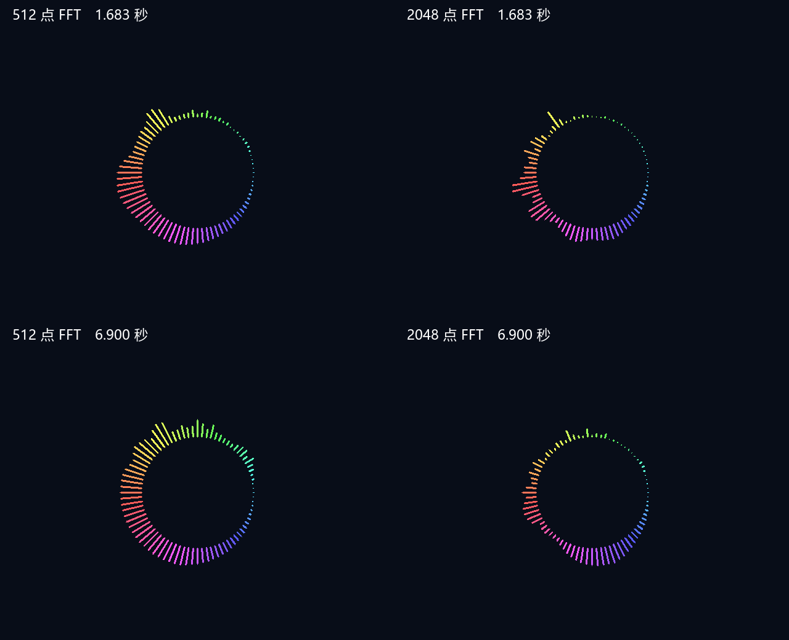

# 2048 点 FFT 与低频独立性

日期：2026-09-28。用户明确要求改为 2048 点，并允许资源占用超过此前的 80% 阈值。

## 本轮实现

板级 `audio_fft_spectrum` 的 `FFT_POINTS` 改为 **2048**，保持 48 kHz 采样率、80 根细圆帽柱、约 6.39 kHz 显示上限、FFT 幅度数组按对数坐标插值，以及 `100*ln(1+0.1*M)` 的定点压缩。

| 参数 | 原 512 点 | 当前 2048 点 |
|---|---:|---:|
| 采样率 | 48 kHz | 48 kHz |
| FFT 频点间隔 | 93.75 Hz | **23.4375 Hz** |
| 每块覆盖音频时间 | 10.6667 ms | **42.6667 ms** |
| 非重叠 FFT 块率 | 93.75 块/秒 | **23.4375 块/秒** |
| FFT RAM 地址宽度 | 9 位 | **11 位** |
| 最后一柱插值邻点 | bin68/bin69 | **bin272/bin273** |

参考项目配置为 44.1 kHz、2048 点，间隔约 21.5332 Hz；当前保持 48 kHz，因此间隔已接近，不能宣称完全相同。

不仅改了顶层参数，也同步扩展：

- 2048 点的 1024 个 Q1.15 旋转因子，10 位旋转因子索引，11 级蝶形。
- Hann 窗坐标按 FFT 点数缩放，复用已有定点 Hann 表；没有改为 Flat-top 窗。
- 对数频率坐标由 16 位扩展到 17 位 Q8，按当前 FFT 点数缩放。
- 幅度缓存读写地址从 8 位扩展为 9 位，深度由 256 扩为 512，避免 bin256 以上折返。
- 扫描结束点改为 bin273，仍只分析当前显示所需部分；FFT 本身计算全部 2048 点。
- 生成器和回归同步支持参考分支 512/1024/2048 点；旧 256/512 频段兼容分支保留。

双缓冲、16 位复数定点数据、逐级除以 2、欧氏幅度平方根、原上升一半/回落八分之一比例及视频帧边界发布保持不变。压缩前的归一化和窗增益等效校正不变；单音幅度不会因点数增加而人为放大四倍。没有自动增益、伪造节拍、采样率转换、动态内圆或色相流动。

顶层仅修改 FFT 实例参数；顶层端口、引脚、PLL、音频播放链和厂商 IP 不变。未生成 bitstream。

## 紫色区域为何更独立

右侧三点钟为第 0 柱，顺时针增加频率。底部附近的对数目标频率不变，但现在可以利用更多独立 FFT bin：

| 柱索引 | 目标频率 | 原 512 点取值 | 当前 2048 点取值 |
|---:|---:|---|---|
| 16 | 约 46.72 Hz | bin0/bin1 | bin1/bin2，主要接近 bin2 |
| 20，正下方 | 约 69.54 Hz | bin0/bin1 | bin2/bin3，主要接近 bin3 |
| 23 | 约 91.53 Hz | bin0/bin1 | bin3/bin4 |

原先三个位置都由被归零的 bin0 与同一个 bin1 插值；现在不再共享唯一幅度源。最右侧极低频的前几柱仍可能共享 bin0/bin1，邻近频率也可能因音乐和 Hann 泄漏相关，不能保证每根柱完全独立。

## 音乐对照

同一 `src/python/1.wav`，48 kHz、24 位立体声左声道，516096 采样、10.752 秒，完整 RTL 重放得到 645 个显示帧。2048 版本有 641 个有声帧，所有这些帧的 80 柱均可按最小短柱规则显示；首 4 帧尚未发布分析数据。

| 音柱等级相关系数 | 512 点 | 2048 点 |
|---|---:|---:|
| 第 16 / 20 柱 | 0.9988 | 0.9057 |
| 第 20 / 23 柱 | 0.9993 | **0.5410** |
| 第 16 / 23 柱 | 0.9977 | **0.5031** |

该片段支持底部部分柱不再近乎完全同步；第 16/20 柱仍有较高相关性。相关系数是该音乐的结果，不是所有歌曲的保证。

| 逻辑柱长统计 | 512 点 | 2048 点 |
|---|---:|---:|
| 平均逐视频帧变化 / px | 1.135 | 0.320 |
| 相邻柱平均高度差 / px | 1.997 | 3.325 |
| 最大柱长 / px | 55 | 46 |
| 本轮封顶柱比例 | 0% | 0% |

更多 FFT 点改善频率细节，不等于动画更快。当前没有重叠窗口，每次需要收集 42.67 ms 的音频；视频帧之间会重复同一分析结果，且原平滑按 FFT 块更新，反应与回落会比 512 点慢。相同音乐的宽带能量分配到更细频点后，整体柱长也可能减小；不应将这些结果描述为整体动态增强。

音乐仿真使用 80 时钟/采样的加速输入，足够让 2048 点计算在下一块前完成，但其相对音频时间的计算延迟大于真实 25 MHz 视频时钟/48 kHz 输入；没有模拟 SD 链路、板级音量及输入时钟跨域。因此该预览用于显示形态和幅度统计对照，不代表板级同一时刻的精确延迟。

以下为实际 RTL 逐像素输出，左为 512 点、右为 2048 点。选取同一源文件 1.683 秒和 6.900 秒的仿真显示帧，不标记为歌曲高潮。未改变板级背景。



结构化统计：[音乐结果](spectrum-2048-wav-2026-09-28.json)。实际板卡尚未验证。

## 仿真与边界

最终 ModelSim 回归全部通过，0 错误、0 告警，包括旧 256/512 分析、参考 512/2048 分析、80 柱直取、兼容渲染、两种视频模式和原启动流程。2048 点新增低频双音 bin2/bin5 独立峰检查、bin270 高位地址不折返至 bin14、初始化完成等待和计算中复位恢复；欧氏幅度逐次与浮点平方根对照，对数曲线误差/单调性、静音和逐时钟帧边界发布检查保留。

80 个对数采样位置不覆盖所有 FFT bin。2048 点使窄峰更窄，特别在高频相邻两柱目标位置间，单频可能被漏显。这不是 FFT 未算到：2413 Hz 测试在 FFT bin103 有强峰，但落在第 65/66 柱约 2314.84/2489.53 Hz 的取样位置之间；显示频率顺序测试在高端使用 2489.5 Hz，另行检查 2413 Hz 的原始峰。当前保留用户要求的直接相邻 bin 插值，不改成每柱覆盖一段频率的峰值汇总，也不把这个窄带漏显现象隐藏成测试通过。

## 工程结果

最终综合 LUT **15462（78.89%）**、REG **10276**、BRAM9K 含 FIFO **53**、BRAM32K **6**、DSP **20**、PLL **2**；0 错误，58 条 HDL/SYN 告警，类别及条数与上一版一致。未出现新的 RAM 推断失败告警。

最终候选执行一次默认布局布线，未修改约束，未生成 bitstream：

| 资源 | 512 点上一版 P&R | 当前 2048 点 P&R |
|---|---:|---:|
| LUT | 15315（78.14%） | **15893/19600（81.09%）** |
| REG | 10381 | 10390/19600（53.01%） |
| BRAM9K，含 FIFO | 41 | **53/64（82.81%）** |
| BRAM32K | 6 | 6/16（37.50%） |
| DSP | 20 | 20/29（68.97%） |
| PLL | 2 | 2/4（50.00%） |

所有资源未超过实际容量。LUT/BRAM9K 超过 80%，符合本轮用户明确放宽的限制。

全局 setup WNS **+0.123 ns**、TNS **0**；视频域 setup WNS **+3.260 ns**，Fmax **27.218 MHz**；SD 域 setup WNS **+0.123 ns**，Fmax **101.245 MHz**。

**全工程时序仍未通过**：全局 hold/removal WNS **−0.075 ns**、TNS **−0.167 ns**，12 个违例终点。最差是 SDRAM 域 `u_video_presentation/add5_syn_189` 至 `u_sdram_read_monitor/frame_signature_reg[23]` 的复位 removal；视频/SD 域也有 −0.020 ns 的 min 检查违例。工具报告 slice 利用率高于 90% 并跳过 hold fix；这是工具的 slice 指标，不等于上表 LUT 利用率。没有放宽约束或改动全局复位、SDRAM 监测、厂商 IP。独立路由 DRC 未报告多驱动或异常时序路径，不能替代时序收敛。

复现与日志：

```text
python src/test/generate_reference_fft_tables.py --check
python src/test/run_spectrum_regression.py --output prj/log/spectrum_2048_final_sim
python src/test/analyze_reference_visual.py prj/log/spectrum_reference/wav.csv prj/log/spectrum_2048/wav.csv docs/spectrum-2048-wav-2026-09-28.json --before-direct --fft-points 2048
```

最终仿真日志 `prj/log/spectrum_2048_final_sim/`；音乐 CSV/重放/预览 `prj/log/spectrum_2048/`；综合与路由报告分别在 `spectrum_2048_syn/`、`spectrum_2048_phy/`，对应完整流程日志为相邻同名 `.log`；DRC 日志 `spectrum_2048_drc.log`。初次单频测试暴露高频窄峰漏显的日志保留，不作为最终回归结果。

上板比较仍需用户生成 bitstream，以相同歌曲与音量检查底部各柱、弱柱和暂停归零；由于当前 hold/removal 仍有违例，正式运行前需处理时序问题。工作区既有工程、PLL 和历史文档改动保留，未纳入本轮提交。
