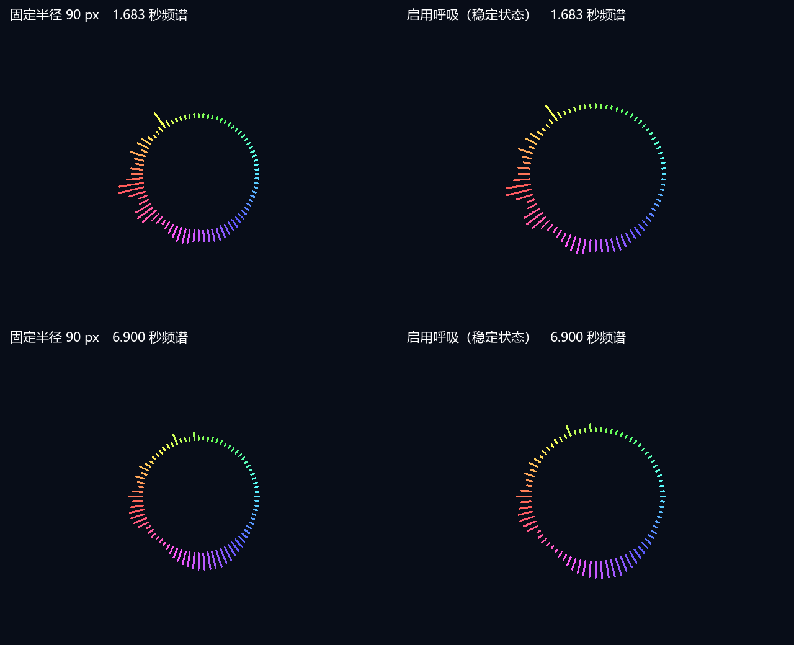

# 8 像素弱柱与音乐呼吸圆环

## 显示行为

参考频谱模式（当前板级配置）有声时最低径向柱长从 4 px 改为 **8 px**。内圆半径随音乐峰值扩张和收缩，范围为 **90～110 px**；强音扩张、弱音收缩。静音仍整圈隐藏，内部呼吸状态逐帧回到 90 px。80 根细线圆帽、固定配色、2048 FFT、48 kHz、音频欠载静音均保持。

每根柱仍按原等级计算独立长度；新增呼吸移动整圈柱根与内圆边界，不改变 FFT 柱数据。8 px 为径向长度，像素圆帽和离散栅格会使实际可见像素数略有差异。

## 参考方法及定点适配

参考源码 `E:/RP2350_FFT_V1.1/RP2350_FFT/src/spectrum_renderer.cpp` 的 `drawCircular` 使用 `0.2*last_max + 0.8*max_magnitude` 平滑峰值，再计算 `base + 3*log2(M+1)`。`main.cpp` 的峰值来自全 FFT 幅度数组。

本工程采用该视觉方法，自行实现以下 Verilog 逻辑，没有复制参考源代码：

- 每个视频帧开始后用 80 个时钟扫描本帧新发布的柱等级，取得最大值。用上一帧完成的结果在下一个视频帧边界更新半径，因而呼吸比柱数据多延迟约一帧。
- 平滑为 `(13*peak + 3*history + 8) >> 4`，即约 81.25% 新值、18.75% 历史值，接近参考 80%/20%。固定系数只用移位与加法。
- 当前柱等级 `P ≈ 100*ln(1+0.1*M)`，用整数阈值表实现 `floor(3*log2(10*(exp(P/100)-1)+1))`，并限制到 0～20 px。完整 0～255 输入与浮点数学式比较通过。
- 平滑的输入是现有 80 根显示柱的峰值，已经经过 FFT 幅度平滑及压缩；参考则在全 FFT 原始峰值上平滑。该适配保留现有 FFT/视频接口，不是逐数值复制参考实现，高频柱没有采到的窄峰不会驱动本工程呼吸。
- 半径平方采用 90～110 的小查表，避免为它增加 DSP。圆帽内边界随半径一起移动。最大柱长 63 px、最大外半径 173 px；几何检测边界扩大至 176 px。
- 新增 `ring_spectrum_renderer.frame_start` 内部输入，由 `video_presentation` 的 VS 上升沿驱动。无顶层端口、管脚、PLL、厂商 IP 或 FFT 改动；视频仍为原两拍呈现延迟。兼容模式保持固定 90 px 和 2 px 最低柱长。

## 验证

ModelSim 局部编译及全部本轮仿真均为 0 错误、0 告警：

- `tb_reference_ring`：80 柱直接取值、8 px 弱柱、对数半径曲线、末柱峰值扫描、13/16 平滑、帧内半径保持、强弱变化、复位与静音、110+63 px 最大边界。
- `tb_ring_spectrum_renderer`：旧兼容模式的插值、细线圆帽、最低高度与静音。
- `tb_video_presentation -gREFERENCE_SPECTRUM=1` 和启动呈现测试：视频叠加、同步和首次预热行为。
- `tb_pcm_audio_player`：继续保持 SD 加载/欠载静音和数据恢复播放。
- `tb_ring_breath_replay`：重放上一轮同一 WAV 的 645 帧已验证 FFT 柱数据，检查峰值扫描、帧内半径稳定和边界。半径为 90～107 px，有声帧半径 5/50/95 分位为 102/105/106 px，半径改变 75 次。该音乐的效果是轻微呼吸，不会强制每拍在整个 20 px 范围来回摆动。结果见 `spectrum-breath-music-2026-09-28.json`。

局部日志：`prj/log/spectrum_breath/`。FFT 数据链路未修改，未重复运行完整 FFT 回归或重新分析音频。音乐重放只验证呼吸逻辑，不代表实际上板音量或精确播放延迟。

预览使用同一 WAV 两个时刻的柱数据：左侧固定 90 px，右侧开启呼吸并保持同组数据五帧，展示稳定状态；两侧均为新的 8 px 最低柱长。实际 RTL 逐像素导出，没有用绘图模型代替渲染器。这是静态对照，不是动态播放录像。

## 工程结果

一次综合、一次默认布局布线均完成，无错误，不生成 bitstream；未修改时序约束。

| 资源 | 综合 | 布局布线 | 芯片容量 |
| --- | ---: | ---: | ---: |
| LUT | 16228（82.80%） | 16621（84.80%） | 19600 |
| REG | 10329 | 10438 | 19600 |
| BRAM9K 含 FIFO | 53 | 53 | 64 |
| BRAM32K | 6 | 6 | 16 |
| DSP | 19 | 19 | 29 |
| PLL | 2 | 2 | 4 |

综合 WARNING 日志匹配 60 行（含工具汇总行），与上一候选数量相同，主要为已有厂商 FIFO 未驱动端口、RAM 初值等告警。布线后 LE 为 18123；工具仍因 slice 利用率超过 90% 跳过 hold fixing，不能与 LUT 百分比混为一谈。

最终全局 setup WNS **+0.101 ns**、TNS 0；视频 setup WNS **+3.186 ns**、Fmax **27.164 MHz**。全局 hold WNS **−0.020 ns**、TNS **−0.066 ns**，最差路径为 SD 音频读者 `fifo_din_reg[24]` 到音频 FIFO `dia[5]`；视频最小检查也有 −0.011 ns。**全工程时序仍未完全通过**。独立路由 DRC 无多驱动、无异常时序路径，该检查不能替代 hold 收敛。

报告日志：`prj/log/spectrum_breath_syn*`、`prj/log/spectrum_breath_phy*`、`prj/log/spectrum_breath_drc.log`。

## 上板观察

处理工程剩余时序问题后由用户生成 bitstream，在相同音量下对照普通段、强音段和静音：弱柱至少约 8 px，内圆随音乐轻微扩张/收缩，同一帧圆环无大小断层，静音全隐藏，SD 加载仍无原方波提示音。当前未做实板验证。
