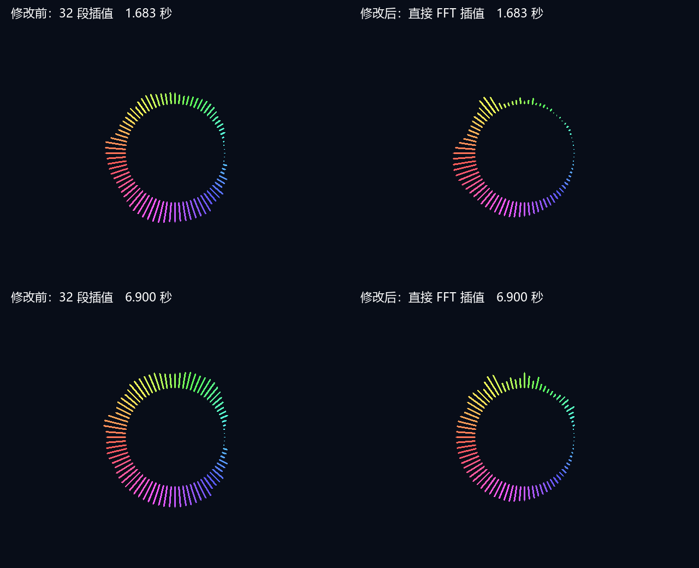

# 参考式 FFT 数据来源与幅度压缩

日期：2026-09-28。对应本轮要求：采样率保持 48 kHz，FFT 提升受 80% 资源限制；显示范围、音柱数据来源、幅度压缩接近 RP2350 参考项目。

## 最终选择

| 项目 | 上一版 | 本轮板级版本 | RP2350 参考代码 |
|---|---|---|---|
| 采样率 | 48 kHz | 48 kHz，不变 | 配置 44.1 kHz |
| FFT 点数 | 512 | **512，1024 候选因超限回退** | 2048 |
| FFT 频点间隔 | 93.75 Hz | **93.75 Hz** | 约 21.53 Hz |
| 最后一柱目标频率 | 约 7.03 kHz | **约 6389.74 Hz** | 约 6389.74 Hz |
| 柱数据 | 32 段峰值/均值汇总，压缩后再插值 | **相邻 FFT bin 的欧氏幅度先插值，再压缩** | 相邻 FFT bin 幅度插值后压缩 |
| 幅度公式 | `24*log2(M/32)`，另有频段补偿 | **定点近似 `100*ln(1+0.1*M)`**，移除分段补偿 | `100*ln(1+0.1*M)` |

1024 点初始候选综合 LUT 15733/19600 = **80.27%**，超过用户阈值，因此未运行该候选布局布线，板级回退 512 点。不能声称频点间隔已经追平参考项目。没有重采样、改变 PLL 或播放速度。

参考项目的 44.1 kHz 是配置值；其 ADC 定时器源码还使用约 22 µs 的定时间隔。这里按参考配置计算频率坐标，不宣称其实测采样率精确等于 44.1 kHz。

## 数据链路与实现

板级 `audio_fft_spectrum` 启用 `REFERENCE_MODE=1`，增加内部 `bars[639:0]`，每字节对应一根柱；第 0 柱位于右侧三点钟，顺时针增加频率。旧 `bands[255:0]` 接口保留用于兼容回归，在参考模式下为零，板级渲染不再使用它。

参考圆环从 320 个显示横坐标中每四个取一柱，80 柱对应：

```text
reference_bin(i) = 320^(i/80) - 1，i=0..79
frequency(i) = reference_bin(i) * 44100 / 2048
fpga_bin(i) = frequency(i) * FFT_POINTS / 48000
M(i) = magnitude[floor(fpga_bin)]*(1-frac) + magnitude[floor(fpga_bin)+1]*frac
height(i) = min(240, 100*ln(1+0.1*M(i)))
```

FPGA 使用 Q8 频点坐标，512 模式最高目标落在 bin68/bin69 之间。bin69 是插值右邻点，**不能把 bin69 的 6468.75 Hz 误认为最后一柱的目标频率**。没有再经过 32 段峰值/均值汇总，也不在压缩后的等级之间做频率插值。

FFT 沿用纯 Verilog 的双缓冲、每级缩放和 Hann 窗；参考分支支持 512/1024 点，兼容分支支持旧 256/512 点。旋转因子由生成器产生，未引入新厂商 FFT IP。参考模式的幅度为 `floor(sqrt(re²+im²))`，平方复用蝶形乘法器，平方根用 16 拍恢复算法，避免额外幅度平方 DSP。

参考输入是去均值后的 12 位 ADC 归一化值，FFT 是未除以 N 的浮点变换；本项目是 24 位 PCM 截取高 16 位、逐级除以 2 的定点 FFT。两者原始数值不能直接套同一个系数。当前先恢复到参考 2048 点归一化幅度尺度，并以 Hann/Flat-top 的平均窗增益作等效校正：

```text
M_ref ≈ magnitude_raw * (2048/32768) * (0.21557895/0.5)
      ≈ magnitude_raw * 0.02694737
M_ref_Q8 ≈ magnitude_raw * 7
```

取 7 相比精确系数约高 1.5%；自然对数用最高有效位及 64 项尾数表近似。对数函数在原始幅度 0～32768 的逐值测试中，相比相同量化输入的浮点 `100*ln()` 误差不超过 2 等级，曲线单调。显示等级上限 240 对应参考屏幕高度，强输入可能按参考方式封顶；不承诺旧版所有大幅度输入仍保持不同等级。当前 WAV 未出现封顶柱。

仍有这些明确差异：保留 Hann 窗，没有改成参考 Flat-top；保留 bin0 排除，没有加入块均值去直流；保留原上升一半、下降八分之一的比例，但现在作用在线性 bin 幅度上；未加入参考的立即上升/加速下落。最新要求未再列出响应方式，所以本轮没有扩展该项。低频分辨率仍受 512 点限制，80 柱和插值不会创造新频点。高频柱采样间隔大于 FFT bin 间隔，窄带单频并不保证每个频率都被某根柱完整显示。

板级渲染仍为 80 根约 3 px 的细圆帽柱、固定彩虹和固定半径。参考模式直接选择 `bars`，取消上一版末四柱人为收短；bin0 为零自然形成低端渐入。首尾差不再强制为零。整组有声时弱柱至少约 2 px，静音后全隐藏。显示长度沿用等级除以 4，最多 60 px；本轮匹配压缩曲线，不复制参考动态半径的完整像素比例。

可见输出仅在视频帧上升边界发布。构建中的 80 柱撤销发布有效标志，完成后整组发布，不暴露部分更新。幅度缓存统一为 256 深度、8 位读写地址，由 BRAM 实现；512 点初次缓存推断失败的中间候选已修正，不作为交付结果。

参考文件只读：`RP2350_FFT/src/graphical_lcd.cpp`、`rp2350_dsp.h`、`main.cpp`、`spectrum_renderer.cpp`。采用算法与公式，未复制参考工程源码。

## 验证结果

最终 ModelSim 回归全部通过，0 错误、0 告警：旧 256/512 兼容模式、参考 512 模式、全部 80 柱直取、兼容渲染、两种视频模式的延迟/优先级和原启动流程。1024 中间候选局部测试也通过，但不作为板级版本。

参考模式额外验证：欧氏幅度逐次与浮点平方根对照、完整对数输入范围的误差和单调性、弱到较强四级单频输入、非整数单频位置顺序、9 kHz 超范围输入、静音收敛、异步复位、FFT 中途复位恢复，以及逐时钟检查可见柱数据只在帧边界变化。

512 点单频四级输入（16 位输入幅度 512/1024/2048/4096）的最大等级为 **28/51/85/130**；313/613/1213/2413 Hz 的最大柱索引为 **37/47/56/66**。这些是选定单频测试结果，不是完整连续扫频的覆盖证明。

同一 `src/python/1.wav`，48 kHz、24 位立体声左声道、10.752 秒，516096 采样，完整 RTL 重放 645 个显示帧。未模拟 SD 播放音量或板级采集噪声。

| 指标 | 上一版 32 段插值 | 本轮直接 FFT |
|---|---:|---:|
| 平均逐帧柱长变化 / px | 1.033 | 1.135 |
| 相邻柱平均高度差 / px | 1.753 | 1.997 |
| 首尾平均高度差 / px | 0（人为收尾） | 0.425 |
| 此 WAV 最大柱长 / px | 47 | 55 |
| 本轮封顶柱比例 | — | 0% |

压缩曲线和尺度不同，不能将这些数字等同于频谱保真度或所有歌曲的动态提升。以下为同一音乐时刻的实际 RTL 像素，左修改前、右修改后；1.683 秒和 6.900 秒，不标记为歌曲高潮。背景用于对照，未更改板级背景。



结构化统计：[音乐结果](spectrum-reference-wav-2026-09-28.json)。实际板卡尚未验证。

## 资源与时序

最终综合：LUT **14970（76.38%）**、REG **10266**、BRAM9K 含 FIFO **41**、BRAM32K **6**、DSP **20**、PLL **2**。0 错误；58 条 HDL/SYN 告警，类别与条数和上一版一致。参考幅度缓存新增的 RAM 初始化告警对应综合工具关闭初值功能，运行时通过初始化状态逐地址清零；不依赖 RAM 上电内容。没有最终 RAM 推断失败告警。

最终候选执行一次默认布局布线，未修改原工程约束，未生成 bitstream：

| 资源 | 本轮结果 | 占用率 |
|---|---:|---:|
| LUT | **15315/19600** | **78.14%** |
| REG | 10381/19600 | 52.96% |
| BRAM9K，含 FIFO | 41/64 | 64.06% |
| BRAM32K | 6/16 | 37.50% |
| DSP | 20/29 | 68.97% |
| PLL | 2/4 | 50.00% |

视频域 setup WNS **+1.292 ns**，报告 Fmax **25.834 MHz**。全局 setup WNS **−0.124 ns**、TNS **−0.124 ns**；最差路径在 `u_sd_audio_reader/cluster_reg[2]` 至 `cluster_offset_reg[29]`，SD 域报告 Fmax **98.775 MHz**，未满足 100 MHz。全局 hold/removal WNS **−0.025 ns**、TNS **−0.079 ns**，最差是 `u_reset_clk/release_sync_reg[2]` 至 `mismatch_count_previous_reg[7/8]` 的复位 removal；视频域也有 −0.005 ns removal。

**全工程时序未通过。** 上一版也有全工程时序遗留；本轮物理布局改变后 SD setup 再次出现违例，不能沿用上一版正 setup 的结论。本轮未扩展修改 SD 读取链、全局复位、厂商 IP 或约束。独立路由 DRC 未发现多驱动或异常路径，不能替代时序收敛。

日志与重现：

```text
python src/test/run_spectrum_regression.py --output prj/log/spectrum_reference_final_sim
python src/test/generate_reference_fft_tables.py --check
python src/test/analyze_reference_visual.py prj/log/spectrum_visual/wav.csv prj/log/spectrum_reference/wav.csv docs/spectrum-reference-wav-2026-09-28.json
```

工程报告位于 `prj/log/spectrum_reference_final_syn/`、`spectrum_reference_final_phy/`，完整流程日志为相邻同名 `.log`；DRC 日志 `spectrum_reference_final_drc.log`。最终新增帧发布/中途复位断言单独重跑日志为 `spectrum_reference_final_sim/reference512_final.log`。音乐 CSV、重放和预览日志在 `prj/log/spectrum_reference/`。1024 超限候选报告在 `spectrum_reference_1024_syn/`。

用户上板比较时使用同一 WAV、同一音量与时刻，检查右侧首尾、高频细节、弱柱及暂停归零。bitstream 由用户生成；当前时序违例仍需在正式运行前处理。工作区既有工程与 PLL 文件改动未纳入本轮提交。
