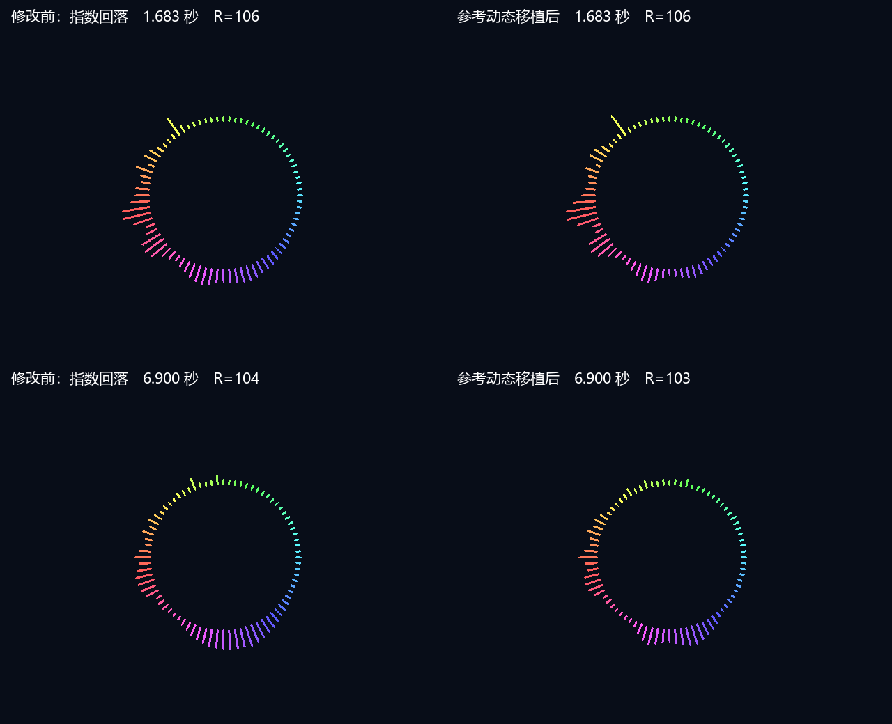

# 移植参考项目的音柱与呼吸响应

## 实现范围

本轮按用户“直接照搬参考项目”的要求，移植本次讨论的三项响应算法：立即上升、重力回落、原始 FFT 峰值呼吸。48 kHz、2048 点、Hann 窗、约 6.39 kHz 显示上限、80 柱、8 px 最低径向柱长、固定配色、内圆 90～110 px 和加载静音保持。没有改为参考项目的 ADC 采样链、Flat-top 窗或完整 UI。

参考来源：`E:/RP2350_FFT_V1.1/RP2350_FFT/src/graphical_lcd.cpp` 的有效 `lcd_task`，`main.cpp` 的 `dsp_max`，`spectrum_renderer.cpp` 的 `drawCircular`。算法移植为可综合 Verilog，保留原项目 MIT 声明于 [RP2350_FFT-LICENSE](third-party/RP2350_FFT-LICENSE)。

## 音柱

幅度历史改为参考幅度 M 的 Q8，继续沿用已有归一化与窗增益换算：原始 FFT 幅度乘 7 约为 `M*256`，相对理想等效换算约 1.5% 偏差。这保证参考的速度单位能直接使用，不把“每次减 1”误当成当前 FFT 整数的 1。

每个有效 FFT 结果更新一次，各 bin 独立处理：

1. 新原始幅度大于历史幅度时，立即采用新值，速度清零。
2. 否则，若历史幅度减速度仍大于零，则减去速度；若不足，则减 1 个参考幅度单位。
3. 速度增加 1，最高为 20。

这是参考代码实际的分支，包含较弱幅度时逐次减 1 的尾段；不是单纯速度增长后直接落到零。零附近增加饱和保护，避免参考表达式产生负数；初始化全部使用的幅度/速度缓存，避免参考局部数组未初始化的问题。稳定单频也可能出现参考规则自身产生的轻微波动。

幅度和 5 位速度打包在同一组 `512x24` RAM 中。80 柱继续按对数坐标取相邻 bin 插值，再做 `100*ln(1+0.1*M)` 显示压缩，上限 240。旧频段兼容分支不修改。

## 呼吸

扫描完整正频率 FFT，包括 bin0 和 Nyquist；2048 模式为 bin0～bin1024。仅显示范围 bin0～bin273 保存历史，其余频点只参与原始峰值。呼吸不再取经过回落和压缩的柱峰值，显示范围以外的原始 FFT 峰也可驱动呼吸，与参考 `dsp_max` 的数据范围一致。

在每块完成时计算 `envelope = (history + 4*raw_peak)/5`，采用 Q8 四舍五入，严格为 0.2/0.8 系数；随后查阈值表实现 `floor(3*log2(M+1))`。只为保持当前圆环尺寸而将扩张限制为 0～20 px；基础半径仍为 90 px。

半径候选与同一块的 80 柱一起生成，在同一个视频帧边界发布。删除渲染器的 80 柱峰值扫描与第二层平滑，所以没有原先“柱子发布后再等一帧”的延迟。FFT 的 42.67 ms 分析窗口、约 6 ms 计算和等候最近视频边界的时间仍然存在。

顶层仅新增内部 8 位半径连线；不改外部端口、管脚、PLL、音频 FIFO、播放链或厂商 IP。视频呈现仍为原两拍流水线。

## 验证方法

- `tb_reference_dynamics` 对照参考浮点递推，检查速度 0～20、减 1 尾段、零饱和、立即上升及速度清零；完整量化幅度范围检查原始峰值半径公式和 4/5 平滑，含最大输入无溢出。
- `tb_reference_fft_spectrum` 保留频率/幅度/双音/复位/静音测试，并检查每块完整 FFT 原始峰值、第一块立即上升、原始峰值包络和柱/半径同帧发布；9 kHz 不形成显示柱，但必须驱动呼吸峰值。
- `tb_reference_ring` 扫描全部 80 柱及 90～110 px 的所有半径，检查 8 px 最低柱长、内外边界、圆帽与静音。
- 旧频段、旧环形、参考视频、首次呈现、PCM 加载/欠载静音一并回归。
- 同一 `src/python/1.wav` 的完整 516096 个左声道采样再经过实际 FFT，记录 645 帧的 80 柱和已发布半径，和上一轮数据比较。音乐仿真用 80 个仿真时钟/采样加速，能覆盖双缓冲持续处理，但不代表实际板级时间延迟。

不再使用旧的 `tb_ring_breath_replay`，因为只重放柱等级无法恢复参考原始峰值。新验证直接重放音频经过 FFT。

最终 256/512 旧模式、512/2048 参考模式、参考动态、环形、视频、首次呈现和 PCM 回归全部通过。2048 单频/双频/静音完整测试运行 7 分 41 秒，0 错误、0 告警。旧测试漏接新增输出产生的两项端口告警已补齐后单独复跑消除，没有重复整套长 FFT 回归。

本轮日志位于 `prj/log/spectrum_reference_dynamics*`。未生成 bitstream，工作区原工程及 PLL 改动保留；实际上板听音和视觉比较仍需用户执行。

## 同一音乐对照

| 指标 | 修改前 | 参考动态移植后 |
| --- | ---: | ---: |
| 音柱平均逐帧长度变化 | 0.268 px | 0.544 px |
| 音柱平均相邻长度差 | 2.563 px | 3.046 px |
| 最大柱长 | 46 px | 52 px |
| 呼吸半径范围 | 90～107 px | 90～108 px |
| 呼吸半径变化次数 | 75 | 145 |
| 呼吸平均逐帧变化 | 0.130 px | 0.311 px |

移植后显示等级的封顶比例为 0。两侧都按 8 px 最低长度比较。半径变化次数增加说明这首音乐中响应更活跃，不代表所有音柱的回落在所有强度下都会更快；参考自身保留了减 1 尾段。

对照图的两侧均使用同一输入采样位置的实际 80 柱及动态半径。左侧来自上一轮，右侧来自本轮；逐像素由 RTL 导出。完整统计见 `spectrum-reference-dynamics-wav-2026-09-28.json`。WAV 日志保存一次运行的调试列，分析 CSV 仅保留 80 柱与已发布半径，不使用进行中的原始峰值调试列作统计。

## 资源与时序

一次综合、一次默认布局布线完成、退出码 0，无错误；没有生成 bitstream。

| 资源 | 综合 | 布局布线 | 容量 |
| --- | ---: | ---: | ---: |
| LUT | 16057（81.92%） | 16419（83.77%） | 19600 |
| REG | 10345 | 10450 | 19600 |
| BRAM9K 含 FIFO | 54 | 54（84.38%） | 64 |
| BRAM32K | 6 | 6 | 16 |
| DSP | 20 | 20 | 29 |
| PLL | 2 | 2 | 4 |

幅度与速度打包使 BRAM9K 比上一候选增加 1 块。综合 WARNING 匹配 60 行（含汇总），与上一候选相同，未新增厂商 IP 修改。布线后 LE 18139，工具继续因 slice 利用率 >90% 跳过 hold fix。

**全工程时序未通过**：全局 setup WNS −0.309 ns、TNS −0.975 ns，最差 SD 音频读者 cluster→cluster_offset；全局 hold/removal WNS −0.068 ns、TNS −0.202 ns，最差 SDRAM 读 FIFO 的 read_len_d0 复位 removal。视频 setup WNS +2.056 ns、Fmax 26.355 MHz，视频最小检查 −0.052 ns。上一候选全局 setup 为正，本候选不能沿用该结论。

独立路由 DRC 无多驱动、无异常时序路径，但这不代表时序收敛。原时钟与约束未放宽，没有进行多轮布局种子搜索或扩展为 SD/全局复位架构修复。
