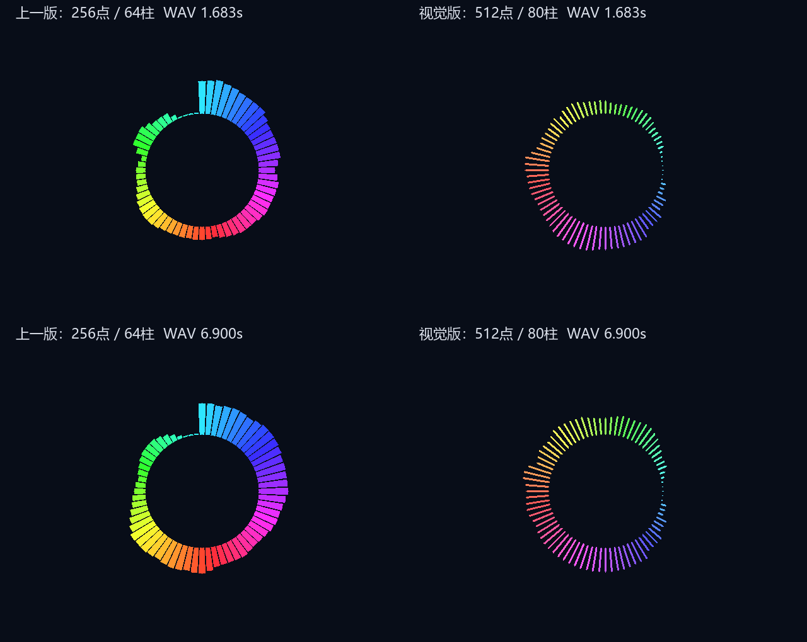

# 环形频谱视觉版：512 点、80 柱与自然衔接

日期：2026-09-27。用户本轮明确允许以视觉效果为主，不要求完全真实的频谱显示。

## 结果与范围

板级从 256 点 FFT 切换为 512 点，48 kHz 下频点间距由 187.5 Hz 降至 93.75 Hz；512 模式单独分析 bin1，不再将 bin1/bin2 合并为一个频段。最高分析 bin75 对应 7031.25 Hz。32 个分析频段和 `bands[255:0]` 接口保留，渲染器重采样为 80 根柱。

采用参考 RP2350 项目的对数频率坐标、细线和圆帽思路，并加入视觉首尾收尾处理。圆环起点移至三点钟方向，沿顺时针频率增加；低频占据更多圆周空间。颜色采用低饱和度的固定循环彩虹，半径固定；参考项目的流动色相、动态内圆半径不属于本轮实现。

首端加入虚拟零幅度，再逐步过渡到 bin1；末四柱按 3/4、1/2、1/4、0 收短。这是有意的视觉处理，不代表这些频率的真实能量变小，也不在最高频与最低频之间混合数据。有声时所有柱至少约 2 像素，所有分析频段衰减到零后整圈消失。

## 源码与流水

- `src/top_tf_hdmi_audio.v`：只把分析器参数改为 512 点，未改变顶层端口、管脚、时钟、音量控制、SD 播放链和厂商 IP。
- `src/audio_fft_spectrum.v`：512 点模式使用新的 32 段表及均值倒数，扫描结束点同步改为 bin75。256 点参数保留上一版频段，仅作为分析器兼容模式；当前渲染表对应 512 点配置。
- `src/ring_spectrum_renderer.v`：80 个扇区，每八分圆 10 柱。Q8 正切常数使用移位加法，不占额外 DSP。柱宽约 3 像素，不再随半径扩大为宽扇形。端部中央保留末端像素，两侧各缩一像素，形成像素级圆帽；不是浮点抗锯齿曲线。
- `src/video_presentation.v`：渲染器新增内部 `clk/rst` 连接，将幅度和几何条件锁存为第一级，呈现模块直接在原第二级合成输出。整条视频仍为两拍延迟，DE/VS 延迟不变。
- 查表由 `src/test/generate_ring_visual_tables.py` 生成。`--check` 同时验证 FFT 频段表、倒数表与渲染表一致。用位平面逻辑选择避免大 case 被 TD 推断为组合 BRAM。

分析器继续保留 Hann 窗、双缓冲纯 Verilog FFT、原始幅度汇总后固定对数映射、约 1→2 倍高频补偿、差值一半上升/八分之一回落。没有自动增益或额外节拍合成。

80 柱的目标频点为 `76^(min(i,76)/76)-1`，按频段中心进行四分之一精度插值。前半圈大约展开 0～0.83 kHz，后半圈扩展到约 7 kHz，末端再收短。512 点仍无法达到参考项目 2048 点约 21.5 Hz 的低频分辨率；新增柱和插值只改善视觉连续性，不创造新的 FFT 分辨率。

## 512 点分析频段对应表

频率列表示实际 FFT bin 中心频率，bin 间隔为 93.75 Hz；不是理想滤波器的通带边界。

| 分析段 | FFT bin | 频点中心范围 / Hz | Q0.7 均值倒数 |
|---:|---:|---:|---:|
| 0 | 1 | 93.75 | 128 |
| 1 | 2 | 187.50 | 128 |
| 2 | 3 | 281.25 | 128 |
| 3 | 4 | 375.00 | 128 |
| 4 | 5 | 468.75 | 128 |
| 5 | 6 | 562.50 | 128 |
| 6 | 7 | 656.25 | 128 |
| 7 | 8 | 750.00 | 128 |
| 8 | 9 | 843.75 | 128 |
| 9 | 10 | 937.50 | 128 |
| 10 | 11 | 1031.25 | 128 |
| 11 | 12 | 1125.00 | 128 |
| 12 | 13 | 1218.75 | 128 |
| 13 | 14 | 1312.50 | 128 |
| 14 | 15 | 1406.25 | 128 |
| 15 | 16 | 1500.00 | 128 |
| 16 | 17 | 1593.75 | 128 |
| 17 | 18–19 | 1687.50–1781.25 | 64 |
| 18 | 20–21 | 1875.00–1968.75 | 64 |
| 19 | 22–24 | 2062.50–2250.00 | 43 |
| 20 | 25–27 | 2343.75–2531.25 | 43 |
| 21 | 28–30 | 2625.00–2812.50 | 43 |
| 22 | 31–34 | 2906.25–3187.50 | 32 |
| 23 | 35–38 | 3281.25–3562.50 | 32 |
| 24 | 39–43 | 3656.25–4031.25 | 26 |
| 25 | 44–48 | 4125.00–4500.00 | 26 |
| 26 | 49–54 | 4593.75–5062.50 | 21 |
| 27 | 55–60 | 5156.25–5625.00 | 21 |
| 28 | 61–66 | 5718.75–6187.50 | 21 |
| 29 | 67–70 | 6281.25–6562.50 | 32 |
| 30 | 71–73 | 6656.25–6843.75 | 43 |
| 31 | 74–75 | 6937.50–7031.25 | 64 |

## 仿真与音乐验证

ModelSim 局部回归通过，0 错误、0 告警：

- 256/512 两种分析器模式：单频、双频、非整数频点、全部 32 段、噪声门限、全域对数单调、静音、复位、计算中途复位、帧边界发布。
- 新 512 点模式：bin1 独立分析，bin110 强单频不应显示在 7 kHz 范围内。低/中/高频 bin3、37、70 输入 −24/−18/−12/−6 dBFS 等级严格递增，无提前封顶，两次更新内上升可见。
- 圆环：全部 80 扇区、全部 32 输入频段都能影响柱长、对数顺序、首尾零幅度、不跨频率绕回、最小短柱、恒定细线、圆帽、配色、静音。
- 视频呈现：额外启用实际频谱叠加，验证第二级输出的延迟与颜色；原 OSD、字幕、锐化和启动测试继续通过。

同一 `src/python/1.wav`（48 kHz、24 位立体声，10.752 秒，516096 个左声道采样）进行完整 RTL 重放，新版 645 个视频帧与上一版同采样时刻对比。重放使用原始文件音量，没有模拟 SD 读取及板级音量设置。统计为逻辑柱长，逐像素预览另由 RTL 渲染器输出。

| 指标 | 上一版 256 点 / 64 柱 | 新版 512 点 / 80 柱 |
|---|---:|---:|
| 平均可见柱数（含首个无数据帧） | 63.901 | 79.752 |
| 首尾柱长差平均值 / px | 48.631 | 0 |
| 首尾柱长差最大值 / px | 58 | 0 |
| 相邻柱平均高度差 / px | 2.057 | 1.753 |
| 平均逐帧柱长变化 / px | 2.161 | 1.033 |
| 此 WAV 中最大柱长 / px | 60 | 47 |

新版 644 个非零帧全部显示 80 柱；首帧无 FFT 数据，整圈隐藏。首尾差为零来自明确的收尾设计，不意味着真实频谱首尾能量相同。逐帧柱长变化减小与柱长比例、低频插值、FFT 更新周期都有关，不能据此宣称动态增强；本轮目标是轮廓更自然、细线更接近参考项目。

以下是实际 RTL 逐像素输出，左为上一版，右为新版。上排取 1.683 秒；下排取新频段总体等级较强的 6.900 秒，不将其称为歌曲高潮。背景色用于对照，不修改板级背景图片。



结构化结果：`docs/spectrum-visual-wav-2026-09-27.json`。

## 工程资源与时序

第一次综合发现角度常数乘法占用过多 DSP，并且像素到柱长到半径平方的组合链过长。仅修改该实现为移位加法、逻辑查表与原视频两级流水中的分拍后再综合；最终候选执行一次默认 P&R，未调用恢复脚本，未修改时序约束，没有生成 bitstream。

最终综合：LUT 15081、REG 9713、BRAM9K（含 FIFO）40、BRAM32K 6、DSP 21、PLL 2。0 错误、58 条告警，与上一版告警条数相同；没有新增频谱/渲染器告警。初始候选的查表 BRAM 端口告警不出现在最终候选。

最终默认 P&R：

| 资源 | 上一版 | 本轮 | 变化 |
|---|---:|---:|---:|
| LUT | 15286 | 15471 / 19600（78.93%） | +185 |
| REG | 9774 | 9802 / 19600（50.01%） | +28 |
| BRAM9K，含 FIFO | 40 | 40 / 64 | 0 |
| BRAM32K | 6 | 6 / 16 | 0 |
| DSP | 21 | 21 / 29 | 0 |
| PLL | 2 | 2 / 4 | 0 |

全局 setup WNS **+0.100 ns**、TNS **0**；视频域 setup WNS **+0.125 ns**，约 25.078 MHz。setup 最差路径位于 SD 音频读取器状态至头部采集数据。

**全工程时序仍不能宣布通过**：全局 hold/removal WNS **−0.012 ns**、TNS **−0.043 ns**。最差 hold 路径位于只读 HDMI 厂商音频 FIFO 写地址；SD 域及视频域还存在约 −0.005 ns 的复位 removal 违例。本轮未修改厂商 IP、复位架构或放宽约束。既有 SDRAM 位置/局部时钟告警保留。

最终生成 `.opt_route.end.f` 和 `SD_to_Video_pr.db`。独立 `report_route_status -drc` 未报告多驱动或异常时序路径；DRC 通过不替代上述时序结果。

缓存日志与报告：

- `prj/log/spectrum_visual_final_syn.log`、`prj/log/spectrum_visual_final_syn/SD_to_Video_gate.area`
- `prj/log/spectrum_visual_final_phy.log`、`prj/log/spectrum_visual_final_phy/SD_to_Video_phy.area`、`SD_to_Video_pr.timing`
- `prj/log/spectrum_visual_final_drc.log`
- `prj/log/spectrum_visual_sim/*.log`
- `prj/log/spectrum_visual/wav.csv`、`wav_detail.csv`、`wav.log`、`*_before.ppm`、`*_after.ppm`

## 重现与上板比较

在已配置 ModelSim 的工程根目录运行：

```text
python src/test/run_spectrum_regression.py --output prj/log/spectrum_visual_sim
python src/test/generate_ring_visual_tables.py --check
```

音乐重放先用 `spectrum_wav_compare.py prepare` 准备左声道 HEX，再编译 `tb_audio_spectrum_wav_compare.v`，使用 `-gFFT_POINTS=512`，传入 `SAMPLES/COUNT/OUTPUT/DETAIL` 四个 plusargs。`analyze_ring_visual.py` 对比上一版与新版 CSV，输出柱长统计与预览帧的 256-bit HEX。`tb_ring_spectrum_preview.v` 接收 `+BANDS=<HEX>` 和 `+FRAME=<绝对或相对 PPM 路径>` 导出真实 RTL 像素；这些测试文件不加入综合文件集。

上板时由用户在 TD GUI 生成 bitstream。采用原歌曲、相同音量、相同普通段与较强段，检查右侧首尾过渡、低频细节、80 柱间隙与细线圆帽；暂停并等待分析等级回落后检查整圈消失。颜色仍固定于柱位置，但频率起点已从顶部旋转到右侧，不能沿用旧版的颜色位置判断。画面和音乐仍需实际板卡确认，本文的预览不是上板照片。
