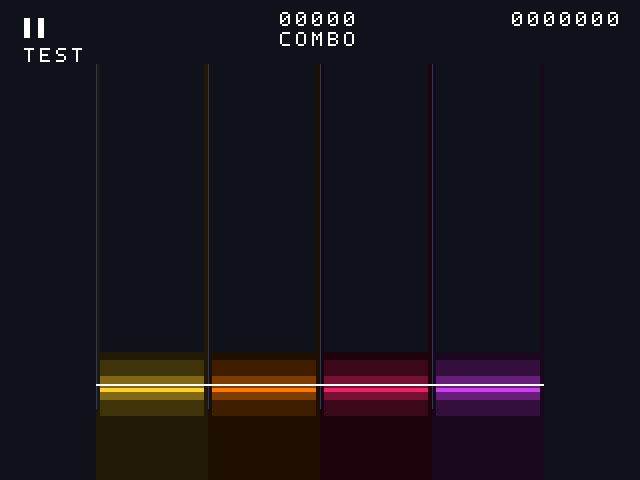

# 扩展触摸区与四轨发光反馈

同日后续修复：无黑框光晕及Hold完整显示长度见 [hold-glow-fix-2026-10-12.md](hold-glow-fix-2026-10-12.md)。下文保留首版发光的记录和预览。

2026-10-12，基于当前 `42586f9`，保留单比较器输入、FFT/SD/缩放资源优化、十字、AUTO、原串口及音画功能。本轮 LUT 和实际 MSlice 检查均通过，最终布线/时序和板上效果尚未验证。

## 操作区

四轨横向范围仍为 `[96,208)`、`[208,320)`、`[320,432)`、`[432,544)`，掩码分别 1/2/4/8。Y 从 `[384,480)` 扩为 **`[352,480)`**，允许在判定线上方 32 像素内按下。

`touch_lane_input.v` 的 `Y0=6962` 对应当前映射的像素 Y>=352，新增 `PIXEL_Y_MIN=352` 供验证脚本读取。硬件仍只比较原始阈值，不计算像素，不新增乘除法/DSP。脚本穷举原始 X/Y 全值域，确认边界相同；测试覆盖 raw_y=6961/6962/6963，以及新区边界的区外滑入和区内移出。

无滑动定义保持：仅首次按下决定是否参与及绑定轨道；区外按下后滑入不触发，区内按下后跨轨或移出仍绑定原轨。修改的是输入命中区域，不是 Tap/Hold 时间窗口。

## 发光

新增渲染器接口 `input_down`、`input_press`，顶层分别接已提交的 `touch_game_down` 和接受事件当拍的 `touch_game_press & {4{touch_game_valid && touch_game_ready}}`。不从十字位置生成反馈，不逐位跨域同步游戏掩码，不让源域释放状态越过尚未接收事件。

- 按下/按住：对应轨道判定线附近出现彩色分段光晕，底部亮条及细侧边光线；复用原四轨黄/橙/粉/紫配色。
- 松开：每两帧衰减一级，约 100 ms 消失（随实际帧率及释放相位略有变化）。
- 快速 Tap：四位 pending_press 保留帧间按下，即使同帧内已松开，下一帧也会亮一下。
- 双押：两轨分别亮；同轨双指保持输入 OR 结果，最后一指松开才开始淡出。
- 手指跨轨：十字可移动，发光继续跟随绑定轨道，不跟随手指位置换轨。
- 暂停、BUFFER、停止、装载、结果及 AUTO 时清除反馈；只在手动 PREROLL/PLAY/TAIL 显示。

发光状态为每轨两位亮度（8位）、短按保持4位及两帧节拍1位。颜色只使用固定的逐通道右移，空间渐变按8像素分段；没有透明度帧缓存、模糊滤波或新DSP。发光先绘制，音符、判定线、HUD 后覆盖，十字仍由原呈现层显示。发光表示输入轨道，不表示命中等级或得分成功。

实际 RTL 仿真预览（四轨帧间短按同时亮起，背景为测试底色）：

## 验证

- `run_touch_lane_regression.py`：131072个原始坐标阈值检查、四轨边界、身份换位、无滑动、同轨/异轨、重武装、CDC/事件顺序、真实引擎 Tap/Hold/AUTO 通过。报告结果对照固定 f9aa991，参考仅将 Y0 改为6962，明确排除本轮有意改变的区域差异；131072份坐标报告、10000份随机状态报告通过。
- `run_touch_glow_regression.py`：按住/双押、帧间快速Tap、帧边界当拍按下、淡出、AUTO/暂停/复位清除通过；实际渲染307200像素预览，校验四轨亮条配色、渐变层次、判定线覆盖优先级及横向范围外不发光。零错误/零告警。
- 原 Stage3 判定窗口、Hold、打包队列及评分通过；原 Stage4 音符、HUD、会话复位、背景、播放、冻结、图片保护及分布式几何测试通过。
- 长会话复位测试在原180秒工具期限内完成部分场景后超时，改为600秒等待后九个场景全部通过，没有改动仿真断言。保留该例既有2条可选 touch_frame_packet 端口告警，以及播放例既有3条可选 bmp_data/response_busy 告警；本轮新增端口均已在旧测试置零。

测试文件不加入板级综合源列表。主要模块沿用原文件，没有新增需加入工程清单的RTL模块。旧资源等价生成器剔除参考渲染器不存在的新反馈端口，保持原基线可运行。

## 一次综合与一次仅布局资源检查

综合目录 `prj/log/touch_glow_syn_20261012`；仅布局目录 `prj/log/touch_glow_place_20261012`。物理工程属性取当前GUI项目，保留 `post_place_opt=medium` 和默认 `hfn_opt_effort=medium`，没有改用户的工程策略。

| 资源 | 当前构建基线 | 本轮 | 增量/余量 |
|---|---:|---:|---:|
| 综合 LUT | 18080 | 18133 / 19600 | +53，余1467 |
| 综合 REG | 10556 | 10558 | +2 |
| 布局后 LUT | 18342 | 18375 / 19600 | 余1225 |
| 实际 MSlice | 4833 | **4886 / 4900** | **余14** |
| BRAM9K / FIFO9K / BRAM32K | 41 / 16 / 11 | 41 / 16 / 11 | 不变 |
| DSP | 22 | 22 | 不变 |
| PLL | 2 | 2 | 不变 |

综合设计告警编号/数量与基线相同（71条带编号的设计告警），没有新模块黑盒和锁存器告警。布局实际完成，不是仅用综合网表估算MSlice。不同阶段及全局重新映射口径不同，不能把逻辑状态13位直接当作全局REG增量。

**MSlice余量仅14个**，后续增加功能仍需再次验证。资源通过不等于时序通过：综合 setup WNS/TNS=-0.978/-7.516 ns；仅布局 setup=-2.891/-10.562 ns、hold=-0.011/-1.122 ns，尚未闭合。最差 setup 在SD WAV `cluster_offset_reg[1]` → `sector_reg[10]`，该时钟布局估计Fmax=77.574 MHz（目标100 MHz）；video_clk布局估计Fmax=34.347 MHz（目标25 MHz）。本轮未修改SD逻辑以扩展任务范围。

没有运行 route，没有生成bitstream；两项开始标记均不存在。最终构建/下载由用户进行，最终布线资源、setup/hold及新板上行为仍需确认。

## 板上验收

进入运行中的手动游戏，先全部松开一次。用十字定位，先测试四轨中心 X=152/264/376/488、Y约360或370，确认判定线上方能产生对应 L 行。Y<352按下仍不参与，必须松开重新按才能参与。

再观察按住持续亮、松开淡出、快速Tap闪光、双押两轨亮、同轨双指最后松开才淡出，以及按住跨轨时发光不换轨。暂停/恢复先等松开；切回AUTO时反馈消失，原自动判定/十字/音画保持。

预览及仿真不代表已上板验收。机器记录见 `docs/reports/touch-lane-glow-2026-10-12.json`。
